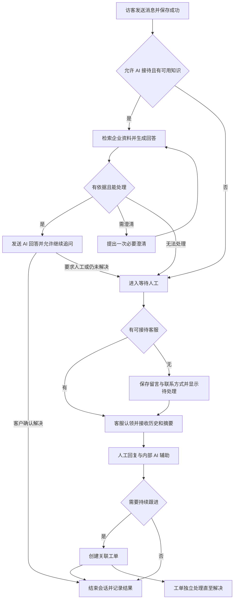

# SmartDesk AI V1 产品需求文档

> 版本：1.0 · 日期：2026-11-06
> 读者：产品负责人、设计、开发与验收人员
> 状态：八个模块与五条业务规则已由用户确认；本文件补齐 V1 产品细节，应用尚未实现。

SmartDesk AI 为 SaaS 和服务型网站提供客服入口：AI 依据企业知识库先回答常见问题，必要时将完整上下文交给人工客服，持续处理的问题通过工单跟进。首版知识来源为手动 FAQ 与粘贴文本资料。

本文件是 V1 产品范围、用户行为和验收的主文档。[接口与事件契约](contracts.md)维护协议字段、枚举表示和技术预算；[架构规范](architecture.md)维护服务职责。需求编号用于后续设计、任务与测试追溯，不表示功能已实现。第 14 节单独列出本次编写采用的默认细节，区别于用户逐项确认的范围。

## 目录导航

- [1 产品目标与成功标准](#1-产品目标与成功标准)
- [2 范围与版本边界](#2-范围与版本边界)
- [3 角色与权限](#3-角色与权限)
- [4 信息架构与页面](#4-信息架构与页面)
- [5 核心业务流程](#5-核心业务流程)
- [6 八个模块的详细需求](#6-八个模块的详细需求)
- [7 状态与业务规则](#7-状态与业务规则)
- [8 AI 回答与知识使用规则](#8-ai-回答与知识使用规则)
- [9 业务数据与字段](#9-业务数据与字段)
- [10 指标口径](#10-指标口径)
- [11 异常体验与非功能要求](#11-异常体验与非功能要求)
- [12 验收矩阵与演示](#12-验收矩阵与演示)
- [13 交付阶段与完成条件](#13-交付阶段与完成条件)
- [14 默认细节与后续技术决策](#14-默认细节与后续技术决策)
- [15 变更与维护](#15-变更与维护)

## 1 产品目标与成功标准

### 1.1 用户问题

| 使用者 | 当前任务与问题 | V1 提供的价值 |
| --- | --- | --- |
| 网站访客 | 希望快速获得产品信息、使用帮助或问题处理，不愿重复描述 | 随时咨询、可主动找人工、交接保留上下文 |
| 客服人员 | 重复答疑占用时间，人工接手时缺少背景，复杂问题容易遗漏 | AI 先答常见问题，交接摘要辅助理解，工单持续跟进 |
| 企业管理员 | 需要控制回答依据、组织接待人员并了解处理情况 | 维护企业知识、成员与配置，查看会话和工单统计 |

### 1.2 目标

- 完成“配置知识 → 网站咨询 → AI 回答 → 必要时人工接管 → 工单跟进”的可演示闭环。
- 对资料不足的问题诚实澄清或转人工，客服能追溯 AI 使用的资料。
- 交接后不会出现 AI 与人工抢答，消息在重试、刷新与断线重连后仍可恢复。
- 两个企业的数据、知识、访客凭据与 AI 结果隔离。
- 作为个人作品，能独立运行、以两个浏览器身份演示，并留下真实的验证与部署说明。

### 1.3 成功标准

发布前满足第 12 节验收；没有跨企业泄漏、重复业务消息、交接后越权自动回复或会话关闭误改工单的硬失败。AI 效果按固定样本验收，阈值是 V1 建议门槛，不是当前实测结果。上线后先观察接待量、转人工原因和人工响应时间，不预设未经验证的自动解决率或商业收入目标。

## 2 范围与版本边界

| 编号 | 已确认模块 | 首版边界 |
| --- | --- | --- |
| M01 | 客户聊天入口 | 网站小窗、演示页、文字咨询、历史恢复、转人工、离线留言 |
| M02 | 知识库 | 手动 FAQ、粘贴文本、维护与启停、试问及内部来源查看 |
| M03 | AI 接待与交接 | 知识问答、追问澄清、转接理由、上下文交接、停止自动回答 |
| M04 | 客服工作台 | 会话列表、接管/分配/转交、内部备注、结束会话、AI 辅助 |
| M05 | 客户资料 | 基础资料、搜索、关联会话和工单 |
| M06 | 工单管理 | 从会话创建、负责人、优先级、四种处理状态、处理记录 |
| M07 | 基础统计 | 会话和 AI 接待量、转人工量/原因、待处理工单、首次人工响应 |
| M08 | 团队与设置 | 登录、企业、成员、两种角色、数据隔离、接入与 AI 配置 |

八模块全部属于 V1，开发分阶段不意味着可以省略后半段功能。五条已确认业务规则见 BR01—BR05。

V1 延后：PDF/文件导入、网站抓取、聊天附件、语音视频、邮件/社交第三方渠道、主动邮件通知、Webhook、支付订阅、复杂 SLA、自动派单、情绪分析、满意度评分、通用工作流、多 Agent 和业务操作工具。AI 不替客户改账户、退款或执行外部系统动作。基本“是否已解决”确认用于结束会话，不是满意度评分系统。

## 3 角色与权限

企业成员只有管理员和客服两种角色；企业创建者默认是管理员。访客不是企业成员，AI 是标明身份的系统发送方，不是可登录账号。

| 能力 | 管理员 | 客服 | 访客 |
| --- | --- | --- | --- |
| 企业配置、成员管理、知识编辑与启停 | 可操作 | 不可操作 | 不可访问 |
| 已启用知识搜索与试问 | 可操作 | 可操作本企业已启用资料 | 只通过聊天得到允许公开的回答 |
| 查看会话 | 本企业全部 | 自己负责的会话、未分配等待队列 | 自己凭据授权的会话 |
| 接管与分配 | 可接管、分配与转交 | 可认领未分配会话、转交自己会话给可接待成员 | 只能请求转人工 |
| 发人工消息、写内部备注、结束会话 | 可处理本企业会话 | 仅自己负责的人工会话 | 可发自己的消息、结束自己的咨询 |
| 客户资料与工单 | 本企业全部 | 仅自己会话/工单关联的客户和自己负责的工单 | 不可访问后台 |
| 工单指派 | 可指派本企业可用成员 | 创建时默认自己；改派由管理员执行 | 不可操作 |
| 企业统计 | 可查看 | 可查看自己的工作量 | 不可访问 |

客服的“全部”指全部有权访问的会话，包括自己的已结束记录和可认领队列，不代表获得全企业客户权限。队列可展示咨询内容与访客语言以便认领；其他客户档案须在取得会话授权后查看。两名客服同时认领时只有一人成功，另一人获得“已被接待”的提示。

至少保留一名有效管理员，不能停用或降级最后一名。成员停用后立即失去访问和接待资格；其未结束人工会话回到等待队列，其未解决工单保留历史负责人并标记待重新指派，管理员收到工作台提示。

## 4 信息架构与页面

| 页面 | 主要内容 | 关键状态 |
| --- | --- | --- |
| 客户聊天小窗 | 欢迎语、AI/人工身份、消息、输入区、转人工、结束咨询 | 首次访问、连接中、AI 生成中、等待人工、人工处理中、离线、已结束 |
| 演示页面 | 示例网站与真实聊天小窗、进入客服端的说明 | 与真实入口共用业务能力，不用静态消息冒充处理 |
| 登录与企业入口 | 注册/登录、创建企业、接受邀请、选择有权限的企业 | 错误凭据、邀请失效、成员停用 |
| 收件箱 | 左侧筛选列表、中间聊天、右侧客户/摘要/工单 | 空队列、未读、分配变化、请求冲突、AI 失败 |
| 知识库 | FAQ/文本列表、编辑详情、启停、试问与依据 | 空知识库、草稿、准备中、可用、失败、停用 |
| 客户 | 搜索列表、基本资料、历史会话与工单 | 匿名访客、未填联系方式、无关联记录 |
| 工单 | 按状态/负责人/优先级筛选，详情与处理记录 | 无负责人、并发修改、已解决、关联会话已结束 |
| 统计 | 时间范围、指标卡、转接原因、数据口径 | 无数据、统计失败、响应样本不足 |
| 设置 | 企业、成员、接待状态、欢迎语、网站接入、AI 与语言 | 配置未完成、接入失败、没有可用知识、AI 已关闭 |

后台一级导航为收件箱、知识库、客户、工单、统计、设置；AI 辅助放在收件箱内。后台默认中文，访客入口和客服翻译先支持中英；后台全面多语言不进入 V1。

所有列表和操作覆盖加载、空、失败、权限不足与提交中；消息更新不抢输入焦点。按钮有文字含义，发送、转人工和关闭可用键盘完成，状态变化有可访问提示。

## 5 核心业务流程

### 5.1 首次配置

管理员注册并创建企业 → 添加 FAQ/文本 → 检查准备状态并启用 → 试问验证 → 设置欢迎语与接入域名 → 在示例站点或自己的站点安装小窗 → 添加客服成员。

没有可用知识或关闭 AI 时，入口仍允许留言/人工咨询，但明确显示人工接待路径，不能假装 AI 已配置完成。

### 5.2 访客咨询与人工交接

“一次必要澄清”按同一未解决诉求计算；下一轮仍缺少依据就转人工，不能循环追问。访客可以在任何未结束状态直接要求人工，不必等待 AI 完成。流程图中的 H 不代表自动派单，默认由客服认领或管理员分配。

### 5.3 工单跟进

客服从会话创建工单 → 确认描述、负责人和优先级 → 按处理进展修改状态并写记录 → 需要客户补充时标记待客户回复 → 收到补充后继续处理 → 标记已解决。

V1 工单属于内部跟进记录，没有独立客户门户或自动通知。客户回复通过仍开放的聊天接收；已结束会话由客服明确重新打开后回复，或客户发起新咨询。记录联系方式不代表系统会自动发送邮件。

## 6 八个模块的详细需求

以下需求全部为 V1 必须实现。每项验收需结合第 7—12 节，不以页面存在代替业务完成。

### M01 客户聊天入口

| 需求 | 行为与边界 | 验收 |
| --- | --- | --- |
| V01 网站接入 | 管理员获取接入代码和演示入口，绑定允许的网站域名；入口携带企业公开标识，不含模型凭据 | 允许域名能建立访客会话；其他域名接入被拒绝或明确提示未授权 |
| V02 访客会话 | 免注册，首条成功保存的消息创建会话；同浏览器、同站点恢复授权历史 | 刷新后恢复已有消息；清除凭据后不凭填写相同邮箱冒认旧会话 |
| V03 文本收发 | 显示待发送、已保存、失败；重试不重复生成消息；断网保留本次草稿 | 重连补齐历史，重复事件只显示一次；已保存不显示为已读 |
| V04 人工与留言 | 始终提供转人工；无人可接待时保留问题，提示可填写姓名与邮箱 | 转接成功后明确等待；联系方式非强制，未填写也不能丢弃咨询 |
| V05 结束与新咨询 | 访客可结束自己的会话；AI 回答后可选择已解决；已结束历史只读，提供新咨询 | 结束未解决问题时记录未确认解决，不自动关闭工单 |

### M02 知识库

| 需求 | 行为与边界 | 验收 |
| --- | --- | --- |
| K01 两种输入 | FAQ 填问题、答案；文本资料填标题、正文。必填字段去除首尾空白后不得为空 | 可保存、重新编辑；PDF/URL 不被当作文件导入或自动抓取 |
| K02 生效与停用 | 新条目默认草稿；启用前完成准备，失败可重试；已启用条目修改后暂不可用于新回答，重新准备后再启用 | 草稿、失败、停用和旧版本均不能被新的自动回答采用 |
| K03 版本与删除 | 每次修改保留版本标识；删除先停用并确认，历史回答保留当时依据快照 | 删除不破坏历史消息；新回答不能引用已删除资料 |
| K04 试问 | 管理员/客服在有权限范围内输入问题，查看回答、来源标题/片段和是否应转人工 | 试问不会创建真实客户会话、发送客户消息或计入业务统计 |
| K05 事实与可见性 | 管理员维护允许对客户使用的知识；完整来源详情仅后台可见，访客看到回答正文 | 模型不能将内部备注、其他企业资料或不在启用集合的知识当作来源 |
| K06 无知识与冲突 | 无可用资料时提示管理员补充；同一事实存在冲突时不擅自选一个答案 | 真实咨询转人工，试问显示资料不足/冲突及可维护的条目 |

### M03 AI 接待与交接

| 需求 | 行为与边界 | 验收 |
| --- | --- | --- |
| A01 自动接待 | 新会话满足 AI 开启和知识可用条件时自动接待；回答标识为 AI | 依据资料完成常见问题回答，客户无需先等待人工 |
| A02 连续上下文 | 支持跟随当前会话追问；新消息使旧回答候选失效，以最新连续上下文处理 | 不发送回答旧问题的迟到结果；补偿不会重复答复同一轮 |
| A03 回答准入 | 产品事实必须有有效资料依据；允许无资料的问候和必要澄清；不能凭空承诺处理结果 | 无依据或冲突时澄清一次后交接；不把模型自报置信分数当作唯一依据 |
| A04 人工请求 | 客户点击、明确要求人工、AI 无法处理、故障或客服主动接管均触发交接 | 请求被服务端接受后立即停止自动回答，无需等摘要生成 |
| A05 交接上下文 | 保存触发人、原因、时间，展示原始聊天；摘要列诉求、已答内容与待处理事项 | 摘要失败仍可接管；摘要不能虚构已完成操作或改变原始历史 |
| A06 离线与开关 | 无人可接待时继续保存消息；AI 关闭使现有 AI 会话进入等待人工；重新开启只作用于新会话 | 等待/人工会话不会因 AI 恢复或开关切换自动回到 AI 接待 |

### M04 客服工作台

| 需求 | 行为与边界 | 验收 |
| --- | --- | --- |
| I01 列表与未读 | 待接待、我的、全部有权访问的会话；按接待状态筛选，展示未读及最后消息 | 切换会话不会串消息；无权限记录不可查询 |
| I02 认领与分配 | 客服原子认领；管理员分配；当前负责人可转交给可接待成员 | 并发认领只有一个负责人；被转交方获得历史，原负责人失去写入资格 |
| I03 人工回复与备注 | 人工消息对访客可见；内部备注有明显独立输入模式；修改/结束操作写操作记录 | 备注不会广播给访客，也不会作为自动接待的知识资料 |
| I04 AI 辅助 | 消息中英翻译保留原文；按需生成回复草稿和会话摘要；草稿先进入编辑器 | 客服编辑不被迟到建议覆盖；只有点击发送才产生人工消息 |
| I05 结束与重开 | 结束时记录结果/原因；管理员或有权限客服可重新打开并由人工继续 | 重开默认人工接待；AI 不自动恢复；关联工单状态保持不变 |

### M05 客户资料

| 需求 | 行为与边界 | 验收 |
| --- | --- | --- |
| C01 基础资料 | 自动建立匿名客户，可补姓名、邮箱、偏好语言和内部备注；邮箱格式校验 | 没有邮箱仍可咨询；非法格式不能保存为有效邮箱 |
| C02 查找与历史 | 在授权范围内按姓名/邮箱搜索，查看关联会话、工单及处理时间 | 不同企业相同邮箱不合并；客服不可借搜索扩大可见范围 |
| C03 身份关联 | 同一访客凭据关联同一客户；邮箱是联系信息，不作为访问历史的凭据 | 清除浏览器数据后新身份不能凭相同邮箱读取旧消息；V1 不提供跨设备合并 |

### M06 工单管理

| 需求 | 行为与边界 | 验收 |
| --- | --- | --- |
| T01 创建与关联 | 从可访问会话创建，预填标题/描述供人工修改；关联客户和会话；负责人默认创建人 | 一次重复提交只有一张工单；同会话已有未解决工单时提示查看，仍可明确新建不同问题 |
| T02 字段与分配 | 标题、描述、负责人、优先级和处理状态；管理员可改派 | 不能指派给其他企业或已停用成员；缺负责人时明确标待分配 |
| T03 状态与记录 | 待处理、处理中、待客户回复、已解决；记录变更人、时间、原因和说明 | 非法/过期修改被拒绝；处理记录不会被后一次修改抹掉 |
| T04 独立跟进 | 会话关闭不改工单；工单解决不自动结束会话；已解决可由授权人员重开 | 重开需填写原因并转处理中；没有 SLA 升级或自动邮件流程 |

### M07 基础统计

| 需求 | 行为与边界 | 验收 |
| --- | --- | --- |
| S01 指标 | 会话量、AI 接待量、转人工量、转接原因、待处理工单、首次人工响应时间 | 与第 10 节定义及可核对样本一致 |
| S02 筛选与权限 | 今天、近 7 天、近 30 天、自选日期；默认按企业时区展示 | 管理员看企业范围；客服仅看本人有归属的工作量，不显示全企业客户明细 |
| S03 数据状态 | 显示统计范围和刷新时间；零记录显示 0，无响应样本显示暂无数据 | 不把统计失败显示为 0，也不把没有响应的会话当作零秒响应 |

### M08 团队与设置

| 需求 | 行为与边界 | 验收 |
| --- | --- | --- |
| O01 登录与企业 | 注册/登录/退出；创建企业；只有成员可进入企业后台；企业创建者为管理员 | 退出或停用后连接失效，切换企业不会保留前一家消息缓存 |
| O02 成员管理 | 管理员创建并复制邀请链接，成员登录后接受；可撤销邀请、改角色和停用成员 | 邀请单次使用、7 天失效；不依赖首版之外的邮件通知；最后管理员受保护 |
| O03 接待可用性 | 客服手动设置可接待/离开；有有效连接且设为可接待才显示在线可接待 | 心跳失效后最多 60 秒不再显示可接待；不承诺排队预计分钟数 |
| O04 入口与语言 | 企业名、欢迎语、接入域名、默认访客语言、客服阅读语言；中英两种访客界面 | 语言切换不覆盖原消息；跨站接入失败给出可操作说明 |
| O05 AI 配置 | 企业可启停 AI 并查看知识准备/服务可用状态；模型提供方配置属于部署设置 | 模型密钥不出现在小窗、浏览器公开配置或访客响应中 |

## 7 状态与业务规则

### 7.1 五条已确认规则

| 编号 | 规则 | 对应需求 | 关键验收 |
| --- | --- | --- | --- |
| BR01 | 客户随时可转人工；资料不足、无法解决或 AI 异常也进入人工流程 | V04、A03—A05 | AT05—AT09 |
| BR02 | 发起转人工后停止自动回答；人工接管后仅提供内部 AI 辅助 | A04、A06、I04 | AT05、AT10—AT12 |
| BR03 | 无人在线保存留言和联系方式，明确待处理 | V04、A06、O03 | AT09、AT13 |
| BR04 | 会话与工单独立，结束聊天不自动解决工单 | V05、I05、T04 | AT17—AT19 |
| BR05 | 消息支持失败重试、断线恢复，AI 故障不阻塞人工聊天 | V03、A06、I03 | AT08、AT20—AT23 |

### 7.2 会话状态

| 状态 | 可发对客回答的一方 | 进入条件 | 离开条件 |
| --- | --- | --- | --- |
| AI 接待 | 业务服务校验后发送 AI 回答 | 新会话且 AI/知识可用 | 转人工、客服接管、AI 关闭/失败或结束 |
| 等待人工 | 可发固定排队/离线系统提示；AI 不答业务问题 | 转人工被接受、AI 不可用或负责人失去资格 | 成功认领/分配进入人工；访客/管理员结束 |
| 人工处理中 | 当前负责人；管理员先接管再回复 | 认领、分配或人工重开 | 转交保持人工；成员停用回等待；明确结束 |
| 已结束 | 不接受新消息 | 访客或有权限成员明确结束 | 授权成员重开进入人工；访客新咨询建立新会话 |

访客在前三种状态均可继续发送补充内容；表中限制的是服务方回答。接管、转交、结束与自动发送必须按同一会话状态顺序裁决。转人工的确认边界是服务端接受状态变更；此前已经保存的 AI 回复保留，此后尚未保存的候选必须取消。客户端先停动画但服务端未接受的情况下，应提示失败并允许重试，不能假报转接完成。

会话结束结果单独记录：客户确认解决、人工标记解决、未确认解决/离开。V1 不根据沉默自动关闭，也不把任一种结束状态直接当作 AI 解决。

### 7.3 工单状态

允许：待处理 → 处理中/已解决；处理中 → 待客户回复/已解决；待客户回复 → 处理中/已解决；已解决 → 处理中（必填重开原因）。标记已解决需填写处理说明。需要补充资料的工单由客服明确标为待客户回复；收到聊天消息不会未经确认自动改状态。

### 7.4 知识生命周期

业务状态为草稿、已启用、已停用，准备状态为未开始、准备中、就绪、失败。只有“已启用且就绪”的当前版本可用于自动回答。修改已启用资料时转为草稿并撤出可用集合，准备成功后需重新启用；不得静默使用旧版本继续回答。

发送前再次检查引用的知识版本和启用状态；若编辑/停用/删除与生成并发，候选失效，基于当前资料重新判断或转人工。历史回答及其授权可见的依据快照保留，不因知识变更重写历史。

## 8 AI 回答与知识使用规则

AI 可以回答产品功能、操作步骤、公开服务政策和资料能支持的其他咨询；自动接待不具备业务操作权限。客户文本、粘贴资料和内部备注都不能改写系统权限或要求泄露另一企业信息。

每次自动回答需满足：会话仍处于 AI 接待、最新客户输入仍匹配、企业 AI 仍开启、知识当前有效、输出符合允许的回复类型。产品事实需有检索到的依据。缺少依据可提出一次澄清；仍无法回答、知识冲突或请求超出范围则交接。

客服后台查看来源标题、版本和支持片段，访客默认只看到自然语言回答；V1 不提供公开知识站或内部资料下载。模型输出的租户、角色、状态、发送指令不具有业务授权意义。

自动接待回复、翻译、摘要、回复草稿是不同结果。自动回复只有通过上述条件才形成消息；翻译和摘要单独展示；草稿需人工编辑确认。内部备注可供当前人工协作查看，默认不送入自动接待或对客草稿生成上下文。

AI 等待期间显示处理中，允许转人工；超过自动接待的产品等待上限进入人工流程，迟到结果丢弃。建议初始上限 30 秒（从客户消息成功保存计时，含排队），技术预算见 contracts；该阈值是默认要求，非已测时延。每个会话单轮只提交一个有效自动回答，新输入到达会使尚未提交的旧候选过期。

## 9 业务数据与字段

这些是产品字段，不是数据库设计。字符串长度按 Unicode code point 计数；默认限制集中在下表，后续技术设计保持一致。

| 对象 | 关键字段与约束 |
| --- | --- |
| 企业 | 名称（1—100 字）、企业时区（默认 Asia/Shanghai）、AI 开关、欢迎语（0—500 字）、默认语言、允许接入域名 |
| 成员 | 登录身份、企业关系、管理员/客服角色、有效/停用状态、接待意愿、连接状态；邀请令牌不可重用 |
| 客户 | 访客身份、姓名（0—100 字）、邮箱（0—254 字，非空时校验）、中英偏好语言、内部备注（0—2000 字） |
| 知识条目 | 类型、FAQ 问题/文本标题（1—200 字）、FAQ 答案（1—8000 字）/文本正文（1—50000 字）、业务/准备状态、版本、更新人/时间 |
| 会话 | 企业、客户、接待状态、负责人、转接原因与时间、创建/结束时间、结束结果；负责人空不等于会话已关闭 |
| 消息 | 会话、发送方及类型（访客/客服/AI/系统）、正文（1—8000 字）、排序序号、保存时间、幂等身份；内部备注独立可见性 |
| 工单 | 标题（1—200 字）、描述（1—8000 字）、关联客户/会话、负责人、优先级（低/普通/高，默认普通）、处理状态、记录 |
| AI 结果 | 输入覆盖范围、生成状态、知识版本、来源快照、模型/提示版本、输出及错误分类；只有授权后台可查看详细依据 |

AI 回答也受对客消息长度限制，超出时重新生成简明答案或转人工，不静默截断造成语义改变。删除客户或批量导出、复杂数据保留策略不属于 V1 自助功能；演示采用合成数据。真实业务部署前应单独确定数据保留、备份恢复与模型服务的数据处理约定。

## 10 指标口径

默认采用企业时区的自然日边界，存储时间独立于展示时区。试问、内部备注、系统排队提示、草稿和重复投递不计为有效对客回答。

| 指标 | 计算口径 |
| --- | --- |
| 新增会话量 | 选定期间内首次客户消息成功保存而创建的不同会话数；重开不重复计入 |
| AI 接待量 | 选定期间新建会话中，至少进入过 AI 接待的会话数；不要求已回答成功 |
| 转人工量 | 选定期间首次进入等待人工/被人工直接接管的不同会话数；一个会话只计一次 |
| 转人工原因 | 首次转接的主原因：客户请求、资料不足/冲突、无法处理、AI 故障、AI 关闭/未配置、客服主动接管；允许保留后续原因记录但不重复统计 |
| 待处理工单 | 查询时未解决的工单总数（待处理、处理中、待客户回复），为当前快照，单独标记，不受会话创建日期筛选误导 |
| 首次人工响应时间 | 第一条成功保存的人工对客回复时间减去首次人工请求/接管时间；包含排队及非在线时段。按首次请求发生在选定期间的会话取已响应样本平均值，并显示样本数及未响应数 |

客服个人工作量按首次人工回复者或当前工单负责人归属并明确显示；无权限查看的企业总体维度不下发。V1 不把“AI 回答过且未转人工”计算为解决率。后台可查看客户明确确认解决的结果记录，独立的自动解决率报表留待口径与样本充分后再扩展。

## 11 异常体验与非功能要求

| 场景 | 用户可观察行为 |
| --- | --- |
| 消息保存失败 | 保留输入并显示失败/重试，不显示已发送成功 |
| 保存成功但确认丢失 | 查询/同请求重试恢复同一消息，不能生成两条 |
| 断线、刷新、事件乱序 | 提示连接状态，重连补齐遗漏内容；草稿与历史按身份隔离 |
| AI 排队、超时、服务不可用 | 进入人工路径；原消息已保存；人工回复继续可用 |
| 知识准备失败或被停用 | 管理员可重试；客服看到不可用原因；客户不收到未经依据支持的回答 |
| 转接/分配冲突 | 显示当前负责人和状态，刷新后再操作，不静默覆盖他人的接待 |
| 摘要/翻译失败 | 显示失败与手动重试，原文及聊天仍可读 |
| 权限撤销 | 停止实时推送，清理相应页面数据并要求重新选择有效身份 |

验收环境目标：普通消息发送状态立即可见；在记录环境条件的双浏览器演示中，对端收到已保存消息的 p95 不超过 2 秒，样本不少于 100 条；AI 30 秒产品等待上限后必须给出可继续的人工路径。上述是待实现验证目标，不是生产性能承诺。多实例广播、压测容量与 SLA 不在本轮承诺范围。

所有业务访问都验证企业、身份和资源权限，HTTP 与实时消息行为一致。内部备注、知识片段、模型凭据和错误堆栈不向访客暴露。AI 与普通消息分开容错；服务重启后已保存消息和已建立工单仍能查询。可访问性至少验证键盘发送/转人工、焦点保留、明确文本状态和小窗窄屏可用。

## 12 验收矩阵与演示

下面是开发后的必测用例；当前均未执行，不代表通过。每条应保存输入、操作、预期、实际结果及对应版本。

| 用例 | 需求映射 | 场景与预期 |
| --- | --- | --- |
| AT01 | O01—O05、V01 | 管理员创建企业、邀请客服、配置站点；受限域名拒绝接入 |
| AT02 | K01—K04 | 新建 FAQ 和文本，准备后启用、试问显示依据，试问不计业务会话 |
| AT03 | V02、A01—A03 | 访客提问资料内问题，得到标明 AI 身份的正确回答及连续追问 |
| AT04 | K02、K03、A03 | 资料编辑/停用/删除后旧候选失效；历史回答保持原记录 |
| AT05 | V04、A04、BR01、BR02 | AI 正在生成时客户转人工；确认后迟到 AI 回复不会发送 |
| AT06 | A03、BR01 | 无依据问题最多澄清一次；仍缺依据时转人工，不循环追问 |
| AT07 | K06、A03、BR01 | 冲突资料或请求实际退款，转人工且不假称已操作 |
| AT08 | A06、BR01、BR05 | AI 服务/队列故障或超过等待上限，消息保留并进入人工路径 |
| AT09 | V04、A06、O03、BR01、BR03 | 无客服在线时允许匿名留言；未填邮箱也保存，有邮箱则校验 |
| AT10 | A05、I02、BR02 | 两客服并发认领只有一人成功，原始历史和摘要可查看 |
| AT11 | A06、I05、BR02 | AI 关闭再开启、人工会话重开均不自动恢复机器人接待 |
| AT12 | I03、I04、BR02 | 内部备注/摘要/草稿不外发；客服编辑后点击发送才产生人工消息 |
| AT13 | V02、V04、BR03 | 访客离开后同浏览器返回，可查看后续人工回复及等待状态 |
| AT14 | C01—C03 | 客户补资料并查看授权历史；相同邮箱不能跨身份读历史 |
| AT15 | O01、O02、C02 | 企业 A 无法检索、读取或生成引用企业 B 知识/消息/工单的结果 |
| AT16 | O02、I02、T02 | 邀请过期/撤销不可用；最后管理员保护；停用成员会话/工单可恢复分配 |
| AT17 | T01、T02、BR04 | 从会话创建工单，重复提交不重复建单，负责人校验有效 |
| AT18 | T03、T04、BR04 | 工单经过四种状态，解决与重开有说明；并发修改不丢记录 |
| AT19 | V05、I05、T04、BR04 | 结束会话不解决工单，解决工单不结束会话 |
| AT20 | V03、BR05 | HTTP/实时通道同时重试同一消息只保存和展示一次 |
| AT21 | V03、BR05 | 确认丢失、广播先到、历史与实时交错，顺序完整无重复 |
| AT22 | V03、O01、BR05 | 刷新/断线恢复历史，切企业不串数据，凭据失效不再推送 |
| AT23 | V03、I03、BR05 | Redis/AI 不可用时已保存消息可查、人工能通过备用发送路径回复 |
| AT24 | S01—S03 | 以可手工核算的不同日期/时区/状态样本验证指标，零数据/无样本区别正确 |
| AT25 | A02、A03、K05 | 提示注入、连续消息、无效模型输出不突破企业或发送边界 |
| AT26 | I04、O04 | 中英翻译保留原文、摘要不伪造事实、语言切换不改历史 |
| AT27 | V01—V05、I01 | 键盘操作、小窗窄屏、焦点保持、加载/空/失败状态可用 |

AI 评测建议准备 50 条固定案例：20 条知识内问题、10 条知识缺失/冲突、10 条转人工/越权请求、10 条中英与多轮语境。每次记录知识、模型和提示版本；答案由人工按事实正确、依据充分、应转则转判分。建议门槛：知识内可接受回答至少 18/20；越权泄漏、无依据业务操作承诺、转人工后发送为 0；其余场景逐项通过边界判断。异常注入测试与真实模型测试分开报告，不能互相代替。

建议演示顺序：管理员添加两类知识 → 访客提问并得到 AI 回答 → 模拟未知问题/主动转人工 → 客服查看摘要接管 → 编辑 AI 草稿发送 → 创建工单 → 结束会话且工单继续处理 → 查看统计。另展示知识停用、断线恢复与企业隔离三个反例。

## 13 交付阶段与完成条件

| 阶段 | 进入条件 | 完成条件 | 后续承接 |
| --- | --- | --- | --- |
| 产品定义 | 八模块五规则已确认 | 本 PRD 与相关规范无矛盾，默认细节可追溯 | 原型与技术设计 |
| 基础客服 | 技术方案与环境确定 | 身份/企业隔离、访客入口、可靠消息、人工接待通过 | 知识与 AI |
| AI 与交接 | 普通消息路径稳定 | FAQ/文本、自动问答、转人工与停发、内部辅助通过 | 客户/工单/统计收尾 |
| V1 验收 | 八模块均已实现 | AT01—AT27、AI 评测、部署说明与演示证据齐备；已知限制明确 | 公开作品交付 |

技术设计应逐项承接需求 ID、状态及验收用例，并补齐接口、数据模型、索引/检索、部署和预算。V1 完成以证据为准；原聊天三周估算不适用于当前未重新估算的完整范围。

## 14 默认细节与后续技术决策

已由用户确认的是产品方向、八模块、五规则、FAQ/文本输入与 PDF/网页导入延后。下列是为补齐 PRD 采用的可调整 V1 默认值，未声称用户逐条审批：

| 决策 | 本文默认 |
| --- | --- |
| 访客身份 | 免注册、同浏览器同站点恢复；邮箱不作为历史访问凭据 |
| 会话结束 | 明确结束，无沉默自动关闭；人工重开，访客另起新咨询 |
| 交接与自动恢复 | 一次必要澄清；转人工后不自动切回 AI；新会话才能重新进入 AI |
| 成员协作 | 两种角色，客服认领队列/处理自己资源，单次邀请链接 7 天失效 |
| 无人在线 | 保留等待会话与可选联系方式，在线归来查看回复；没有自动邮件 |
| 知识修订 | 修改已启用条目先撤出可用集合，准备后重新启用 |
| 语言与时区 | 中英访客/翻译、中文后台，企业默认 Asia/Shanghai |
| 限制与验收目标 | 第 9 节长度、30 秒 AI 等待、60 秒接待状态失效、消息 p95/评测门槛 |

不在 PRD 中提前锁定的技术细节：检索与索引算法、模型/Embedding 提供方、跨站访客凭据的实现、部署主机与容量、数据表/完整 API、流式生成呈现方式。实现必须满足上述产品行为；不得以技术细节未定为由删减已确认模块，也不得自行扩展业务范围。

## 15 变更与维护

2026-11-06，V1.0：依据用户逐步确认，形成 AI 优先接待的八模块与五规则需求；知识输入限 FAQ 和文本。相关规范统一区分自动接待发送与人工草稿确认，角色收敛为管理员/客服，工单包含待客户回复。

后续变更说明受影响的需求 ID、状态、权限、验收和版本。产品语义更新本文件，协议表示同步 contracts，服务边界同步 architecture/agent，质量用例同步 quality。历史讨论报告仅作过程记录，不覆盖本 PRD 的当前产品基线。
